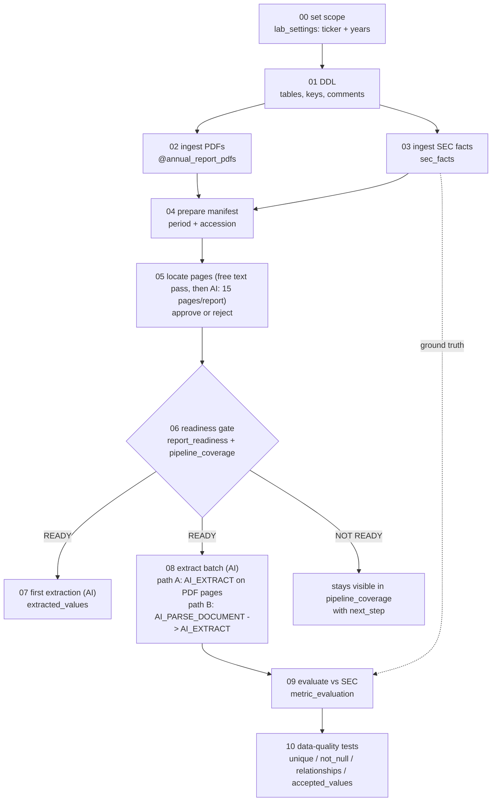
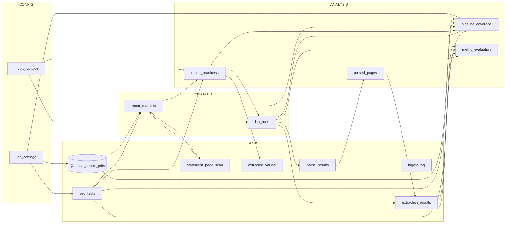

# Architecture

How the lab's code and data connect: the pipeline flow, the data layers, and a catalog
of every table with its grain and key. For how this maps to dbt and a scheduled DAG,
see [PRODUCTION.md](PRODUCTION.md).

The diagrams are [Mermaid](https://mermaid.js.org/), which GitHub renders. If your
viewer shows them as code, read the text version under each one.

## 1. Pipeline flow



Text version:

```text
00 scope ─► 01 DDL ─┬─► 02 PDFs ──────┐
                    └─► 03 SEC facts ─┼─► 04 manifest ─► 05 locate pages (AI) ─► 06 READINESS GATE
                                      │                                         │ READY       │ NOT READY
                                      │                                         ▼             ▼
                                      │                     07 first extraction (AI)   pipeline_coverage
                                      │                     08 batch: path A + path B (AI)   (next_step)
                                      │                                         │
                                      └──────── ground truth ──────────────────►09 evaluate ─► 10 tests
```

`python/00.run_pipeline.ipynb` runs this whole flow in order from the files themselves.
AI steps (05, 07, 08) and internet steps (02, 03) are behind explicit gates and are
reported as `SKIPPED` when off, never silently left out.

## 2. Data layers and lineage

| Layer | Meaning | Rule |
| --- | --- | --- |
| CONFIG | settings and reference data people edit | changed only deliberately (00, 01) |
| RAW | data as received from a source or an AI call | append/upsert only; never hand-edited |
| CURATED | reviewed business entities | one row per entity; approvals recorded with evidence |
| ANALYSIS | views derived from the layers above | never written to; always recomputable |



Text version: `lab_settings` decides what 02/03 load into the stage and `sec_facts`;
04 turns staged PDFs plus `sec_facts` into `report_manifest`; 05 writes
`statement_page_scan` and approves manifest rows; 06's views read the manifest, SEC
facts and catalog; 08 snapshots READY reports into `lab_runs` and writes
`parse_results` and `extraction_results`; 09's views join those back to `sec_facts`.

## 3. Table catalog

Keys are declared in `sql/01.ddls.sql` (Snowflake does not enforce them) and tested in
`sql/10.validation.sql`. Each table's layer and grain are also stored as its Snowflake
table comment.

| Object | Layer | Grain (one row is...) | Key | Written by | Read by |
| --- | --- | --- | --- | --- | --- |
| `lab_settings` | CONFIG | the scope (exactly one row) | `setting_id` | 00 | 02, 03, 04-09 |
| `metric_catalog` | CONFIG | one extractable metric | `metric_id` | 01 | 06, 08, 09 |
| `statement_heading_patterns` | CONFIG | one heading wording per statement type | statement_type, pattern | 01 | 05 |
| `@annual_report_pdfs` | RAW | one PDF file `<TICKER>/<YEAR>.pdf` | path | 02 (or `load_starter`) | 04, 05, 07, 08 |
| `sec_facts` | RAW | one XBRL observation (concept, unit, period, filing) | unique: ticker, accession, concept, unit, start/end date, form, fiscal year/period, frame | 03 | 04, 06, 07, 09 |
| `ingest_log` | RAW | one download/load attempt | none (event log) | 02, 03 | people (04 shows it) |
| `statement_page_scan` | RAW | one page used to locate statements: `TEXT` (free text layer), `WINDOW` (AI parse), `TOC` (legacy) | relative_path, scan_type, page_index | 05 | 05 |
| `parse_results` | RAW | one AI_PARSE_DOCUMENT result per run | run_id (FK lab_runs) | 08 | 08, 09 |
| `extraction_results` | RAW | one AI_EXTRACT result per run and method | run_id, method (FK lab_runs) | 08 | 06, 09 |
| `extracted_values` | RAW | one exploratory extraction per report | relative_path | 07 | 07 |
| `synthetic_ground_truth` | RAW | one expected answer per synthetic PDF and metric | relative_path, metric_id | 11 | 12, 13 |
| `report_manifest` | CURATED | one staged annual report | relative_path | 04, 05 (manual override in 04) | 06-08 |
| `lab_runs` | CURATED | one report in one 08 batch, with its exact questions | run_id (FK report_manifest) | 08 | 06, 08, 09 |
| `report_readiness` | ANALYSIS | one in-scope report | relative_path | 06 (view) | 06, 07, 08 |
| `pipeline_coverage` | ANALYSIS | one year in scope (built from the scope) | ticker, report_year | 06 (view) | 06, 09, runner |
| `parsed_pages` | ANALYSIS | one parsed page of one run | run_id, page_index | 08 (view) | 08, 09 |
| `metric_evaluation` (+ `extracted_fields`, `normalized_extractions`, `sec_reference`, `compared_values`) | ANALYSIS | one metric x method x run | run_id, method, metric_id | 09 (views) | 09, 10 |

## 4. Verified end-to-end run

Run on 2026-11-20 with `python/00.run_pipeline.ipynb`, scope AAPL 2021-2025, both gates on:

- 02: all 5 PDFs downloaded; 03: 174 SEC facts loaded.
- 04/05: every year got its own 10-K accession and fiscal dates; 05 auto-approved 2021,
  2022 and 2025 (pages `[31, 37)`), with 2023 (human-reviewed, `[30, 36)`) and 2024 unchanged.
- 06: all 5 years `READY`; `pipeline_coverage` showed `COMPLETE through 08` for every year.
- 07: 15 of 15 values `MATCH` SEC facts. 08 + 09: latest batch 30 of 30 `PASS`
  (3 metrics x 2 methods x 5 years).
- 10: 27 of 27 data-quality checks `PASS`.
- Re-running every 07/08 insert afterwards inserted 0 rows (no duplicate runs, no repeat AI cost).

### Follow-up runs (2026-11-20)

- **All ten metrics, AAPL 2021-2025** (`include_all_metrics = TRUE`, prompt_version `e0c533bd...`):
  100 of 100 `PASS` (10 metrics x 2 methods x 5 years). The 3-metric runs (prompt_version
  `b222ba0f...`) remain 36 of 36. 09's "pass rate by prompt_version" query shows both.
- **`only_new_reports` check:** re-running 08 with the same questions inserted 0 runs.
- **Second company, MSFT 2023-2024** (generalization test): ingestion, SEC facts and the
  June fiscal year worked (accessions `0000950170-23-035122`, `0000950170-24-087843`;
  periods 2022-07-01..2023-06-30 and 2023-07-01..2024-06-30). Step 05 marked both reports
  `AUTO-REJECTED` with every item NOT FOUND, and `pipeline_coverage` showed
  `05 locate pages`, so nothing was skipped silently. Cause: Microsoft's PDF is the
  glossy annual report; pages 0-5 are the shareholder letter, not the 10-K table of
  contents, and page footers are bare numbers, not Apple's `10-K | N`.
  The MSFT rows remain in the schema as history; they do not appear in AAPL coverage.
- **Page locator generalized (step 05, verified 2026-11-20).** 05 no longer depends on
  Apple's layout. A free text pass (`pdf_page_text`, pypdf, no AI charge) reads every
  page; the anchor is the page whose top says "Item 8. Financial Statements and
  Supplementary Data", confirmed by a statement heading within 5 pages. If the report has
  an index, its printed page plus the footer offset (measured near that page, 3 pages
  must agree) must land within 2 pages of the anchor. Only then does AI_PARSE_DOCUMENT
  parse a 15-page window (was ~21 pages). Heading wording lives in the CONFIG table
  `statement_heading_patterns`; limits live in `lab_settings`. `report_manifest.locator_method`
  records the outcome:

  | locator_method | meaning | verified on |
  | --- | --- | --- |
  | `TEXT+INDEX` | heading found, index agrees | AAPL 2021-2025 (same ranges as before), TSLA 2023-2024 |
  | `TEXT` | heading found, no index | MSFT 2023-2024 |
  | `MANUAL_REVIEW` | heading and index disagree; not parsed | none yet |
  | `AI_FALLBACK` | no text layer (scanned PDF); AI parses pages 0 to `ai_fallback_page_cap` | none yet |
  | `NOT_FOUND` | text exists, no heading matched; add the wording to `statement_heading_patterns` | none yet |

  Located windows (zero-based PDF pages): AAPL 30 (2023: 29), MSFT 43, TSLA 2023 46,
  TSLA 2024 47. TSLA showed two traps the design handles: tabs between words in the text
  layer (whitespace is normalized) and page numbering that shifts by one mid-report (the
  offset is measured only near the index page). TSLA's printed numbering starts after
  the unnumbered 10-K cover (PDF location 5, zero-based page 4, prints "4").
- **End-to-end on the new locator (2026-11-20, 3 starter metrics):**

  | Report | 05 approved range | 07 | 09 (both methods) |
  | --- | --- | --- | --- |
  | MSFT 2023, 2024 | [43, 49) `TEXT` | 6 of 6 MATCH | 12 of 12 PASS |
  | TSLA 2023 | [49, 56) `TEXT+INDEX` | 3 of 3 MATCH | 6 of 6 PASS |
  | TSLA 2024 | [50, 57) `TEXT+INDEX` | 3 of 3 MATCH | 5 of 6 PASS |

  The TSLA 2024 miss is DIRECT_PDF assets: the value was right (122,070 million, as SEC)
  but returned as `"122070."` with a trailing point, which `lab_number` rejects as not a
  clean number (`MISSING_OR_INVALID_VALUE`). The scoring rule was left strict. Validation:
  32 of 32. Scope restored to AAPL 2021-2025.
- **Raw-value wording fixed and scale verified directly (2026-11-20).**
  - *Cause of `"122070."`:* our own 08 question asked for the number "with a decimal
    point and no ... separators". The AI removes the comma because we ask it to
    (ingestion never changes the PDF or its text), and one answer took "with a decimal
    point" literally. The wording is now: "Include a decimal point only if the printed
    number has decimal digits, and keep those digits (122,070 becomes 122070; 2.04 stays
    2.04)". New prompt_version `e0d3a161...`; earlier runs keep theirs.
  - *Re-run, TSLA 2024 only:* raw values `122070`, `97690` and `2.04`; 3 of 3 PASS on both
    methods (was 5 of 6). `lab_number` stays strict.
  - *How the table scale is handled:* 08 asks three separate questions per metric: the
    printed number (scale not applied), the multiplier (`__scale`: 1, 1000, 1000000 or
    1000000000; per-share amounts use 1 even in a table "in millions, except per share
    data"), and evidence quoting the line, column and table scale note. 09 multiplies the
    number by the multiplier and compares the result with SEC's figure in base units.
    Two rules check the multiplier on its own: `INVALID_EPS_SCALE` (per share must be 1)
    and, new, `SCALE_EVIDENCE_MISMATCH`. The new rule uses `lab_scale_matches_evidence`:
    a currency amount's multiplier must agree with the quoted note (1000 needs
    "thousand", 1000000 "million", 1000000000 "billion"; 1 must not quote an "in
    thousands/millions/billions" note). Before this rule, a wrong scale was caught only
    because the scaled number would miss SEC by 1,000 times. On every existing row the
    new rule agreed (120 currency rows, all scale 1000000 with "millions" quoted), so no
    earlier result changed. 10 tests it with 9 cases.
