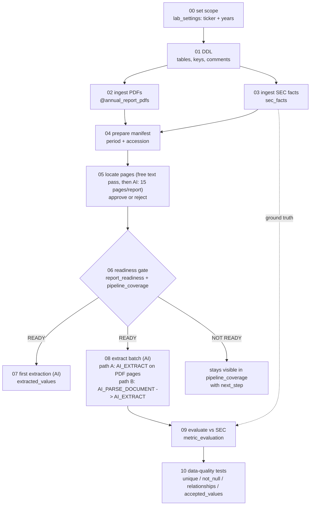
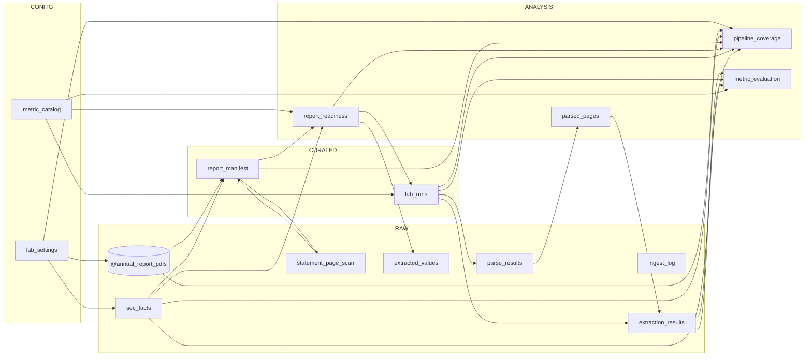

# Architecture

How the lab's code and data connect: the pipeline flow, the data layers, and a catalog
of every table with its grain and key. For how this maps to dbt and a scheduled DAG,
see [PRODUCTION.md](PRODUCTION.md).

The diagrams are [Mermaid](https://mermaid.js.org/), which GitHub renders. If your
viewer shows them as code, read the text version under each one.

## 1. Pipeline flow



Text version:

```text
00 scope ─► 01 DDL ─┬─► 02 PDFs ──────┐
                    └─► 03 SEC facts ─┼─► 04 manifest ─► 05 locate pages (AI) ─► 06 READINESS GATE
                                      │                                         │ READY       │ NOT READY
                                      │                                         ▼             ▼
                                      │                     07 first extraction (AI)   pipeline_coverage
                                      │                     08 batch: path A + path B (AI)   (next_step)
                                      │                                         │
                                      └──────── ground truth ──────────────────►09 evaluate ─► 10 tests
```

`python/00.run_pipeline.ipynb` runs this whole flow in order from the files themselves.
AI steps (05, 07, 08) and internet steps (02, 03) are behind explicit gates and are
reported as `SKIPPED` when off, never silently left out.

## 2. Data layers and lineage

| Layer | Meaning | Rule |
| --- | --- | --- |
| CONFIG | settings and reference data people edit | changed only deliberately (00, 01) |
| RAW | data as received from a source or an AI call | append/upsert only; never hand-edited |
| CURATED | reviewed business entities | one row per entity; approvals recorded with evidence |
| ANALYSIS | views derived from the layers above | never written to; always recomputable |



Text version: `lab_settings` decides what 02/03 load into the stage and `sec_facts`;
04 turns staged PDFs plus `sec_facts` into `report_manifest`; 05 writes
`statement_page_scan` and approves manifest rows; 06's views read the manifest, SEC
facts and catalog; 08 snapshots READY reports into `lab_runs` and writes
`parse_results` and `extraction_results`; 09's views join those back to `sec_facts`.

## 3. Table catalog

Keys are declared in `sql/01.ddls.sql` (Snowflake does not enforce them) and tested in
`sql/10.validation.sql`. Each table's layer and grain are also stored as its Snowflake
table comment.

| Object | Layer | Grain (one row is...) | Key | Written by | Read by |
| --- | --- | --- | --- | --- | --- |
| `lab_settings` | CONFIG | the scope (exactly one row): ticker, years, metric set (`include_all_metrics`) | `setting_id` | 00 | 02, 03, 04-09 |
| `metric_catalog` | CONFIG | one extractable metric; `is_starter` marks the starter set (the only place it is named) | `metric_id` | 01 | 06, 08, 09 |
| `metric_sec_concepts` | CONFIG | one accepted SEC concept per metric: preference 1 = `metric_catalog.sec_concept`, higher = a recorded fallback with its `reason` | metric_id, concept (FK metric_catalog) | 01 | 06 (`metric_ground_truth`) |
| `statement_heading_patterns` | CONFIG | one heading wording per statement type, with the report it was `added_for` (written once) | statement_type, pattern | 01 | 05, 06 |
| `@annual_report_pdfs` | RAW | one PDF file `<TICKER>/<YEAR>.pdf` | path | 02 (or `load_starter`) | 04, 05, 07, 08 |
| `sec_facts` | RAW | one XBRL observation (concept, unit, period, filing) | unique: ticker, accession, concept, unit, start/end date, form, fiscal year/period, frame | 03 | 04, 06, 07, 09 |
| `ingest_log` | RAW | one download/load attempt | none (event log) | 02, 03 | people (04 shows it), `report_status` |
| `ddl_applied` | RAW | one DDL file the runner applied without error, with its SHA-256 | file_name | runner (`sql_runner.record_ddl_applied`) | runner (`sql_runner.ddl_status`) |
| `statement_page_scan` | RAW | one page used to locate statements: `TEXT` (free text layer), `WINDOW` (AI parse), `TOC` (legacy) | relative_path, scan_type, page_index | 05 | 05 |
| `parse_results` | RAW | one AI_PARSE_DOCUMENT result per run | run_id (FK lab_runs) | 08 | 08, 09 |
| `extraction_results` | RAW | one AI_EXTRACT result per run and method | run_id, method (FK lab_runs) | 08 | 06, 09 |
| `extracted_values` | RAW | one exploratory extraction per report | relative_path | 07 | 07 |
| `synthetic_ground_truth` | RAW | one expected answer per synthetic PDF and metric | relative_path, metric_id | 11 | 12, 13 |
| `report_manifest` | CURATED | one staged annual report | relative_path | 04, 05 (manual override in 04) | 06-08 |
| `lab_runs` | CURATED | one report in one 08 batch, with its exact questions | run_id (FK report_manifest) | 08 | 06, 08, 09 |
| `metric_ground_truth` | ANALYSIS | one report period (ticker, accession, fiscal start/end) x metric: the SEC value from the report's own 10-K and which concept supplied it (`concept_used`, `preference_used`) | ticker, sec_accession, period_start, period_end, metric_id | 06 (view) | 06, 09, `report_status` |
| `scope_metrics` | ANALYSIS | one metric in play for the current scope: starter metrics, or all when `include_all_metrics` | metric_id | 06 (view) | 06, 08, 09, 10 |
| `report_readiness` | ANALYSIS | one in-scope report (ground truth required for every metric in play; `missing_metrics` names gaps) | relative_path | 06 (view) | 06, 07, 08 |
| `pipeline_coverage` | ANALYSIS | one year in scope (built from the scope) | ticker, report_year | 06 (view) | 06, 09, runner |
| `heading_pattern_usage` | ANALYSIS | one heading pattern, with the reports it matches today (all companies and years) | statement_type, pattern | 06 (view) | people, export |
| `parsed_pages` | ANALYSIS | one parsed page of one run | run_id, page_index | 08 (view) | 08, 09 |
| `metric_evaluation` (+ `extracted_fields`, `normalized_extractions`, `sec_reference`, `compared_values`) | ANALYSIS | one metric x method x run | run_id, method, metric_id | 09 (views) | 09, 10 |
| `report_status` | ANALYSIS | one ticker-year the lab has touched, ALL companies (scope, `ingest_log`, stage or manifest), including years whose PDF was never found: status, `next_step`, ground truth X/10, latest scores | ticker, report_year | 09 (view) | export `SUMMARY.md`, 10, people |
| `method_comparison` | ANALYSIS | one ticker x year x method for each report's latest run: pass rate, confidence, low-confidence answers, parsed characters | ticker, report_year, method | 09 (view) | export `SUMMARY.md`, 10, people |

## 4. Verified end-to-end run

Run on 2026-11-20 with `python/00.run_pipeline.ipynb`, scope AAPL 2021-2025, both gates on:

- 02: all 5 PDFs downloaded; 03: 174 SEC facts loaded.
- 04/05: every year got its own 10-K accession and fiscal dates; 05 auto-approved 2021,
  2022 and 2025 (pages `[31, 37)`), with 2023 (human-reviewed, `[30, 36)`) and 2024 unchanged.
- 06: all 5 years `READY`; `pipeline_coverage` showed `COMPLETE through 08` for every year.
- 07: 15 of 15 values `MATCH` SEC facts. 08 + 09: latest batch 30 of 30 `PASS`
  (3 metrics x 2 methods x 5 years).
- 10: 27 of 27 data-quality checks `PASS`.
- Re-running every 07/08 insert afterwards inserted 0 rows (no duplicate runs, no repeat AI cost).

### Follow-up runs (2026-11-20)

- **All ten metrics, AAPL 2021-2025** (`include_all_metrics = TRUE`, prompt_version `e0c533bd...`):
  100 of 100 `PASS` (10 metrics x 2 methods x 5 years). The 3-metric runs (prompt_version
  `b222ba0f...`) remain 36 of 36. 09's "pass rate by prompt_version" query shows both.
- **`only_new_reports` check:** re-running 08 with the same questions inserted 0 runs.
- **Second company, MSFT 2023-2024** (generalization test): ingestion, SEC facts and the
  June fiscal year worked (accessions `0000950170-23-035122`, `0000950170-24-087843`;
  periods 2022-07-01..2023-06-30 and 2023-07-01..2024-06-30). Step 05 marked both reports
  `AUTO-REJECTED` with every item NOT FOUND, and `pipeline_coverage` showed
  `05 locate pages`, so nothing was skipped silently. Cause: Microsoft's PDF is the
  glossy annual report; pages 0-5 are the shareholder letter, not the 10-K table of
  contents, and page footers are bare numbers, not Apple's `10-K | N`.
  The MSFT rows remain in the schema as history; they do not appear in AAPL coverage.
- **Page locator generalized (step 05, verified 2026-11-20).** 05 no longer depends on
  Apple's layout. A free text pass (`pdf_page_text`, pypdf, no AI charge) reads every
  page; the anchor is the page whose top says "Item 8. Financial Statements and
  Supplementary Data", confirmed by a statement heading within 5 pages. If the report has
  an index, its printed page plus the footer offset (measured near that page, 3 pages
  must agree) must land within 2 pages of the anchor. Only then does AI_PARSE_DOCUMENT
  parse a 15-page window (was ~21 pages). Heading wording lives in the CONFIG table
  `statement_heading_patterns`; limits live in `lab_settings`. `report_manifest.locator_method`
  records the outcome:

  | locator_method | meaning | verified on |
  | --- | --- | --- |
  | `TEXT+INDEX` | heading found, index agrees | AAPL 2021-2025 (same ranges as before), TSLA 2023-2024 |
  | `TEXT` | heading found, no index | MSFT 2023-2024 |
  | `MANUAL_REVIEW` | heading and index disagree; not parsed | none yet |
  | `AI_FALLBACK` | no text layer (scanned PDF); AI parses pages 0 to `ai_fallback_page_cap` | none yet |
  | `NOT_FOUND` | text exists, no heading matched; add the wording to `statement_heading_patterns` | none yet |

  Located windows (zero-based PDF pages): AAPL 30 (2023: 29), MSFT 43, TSLA 2023 46,
  TSLA 2024 47. TSLA showed two traps the design handles: tabs between words in the text
  layer (whitespace is normalized) and page numbering that shifts by one mid-report (the
  offset is measured only near the index page). TSLA's printed numbering starts after
  the unnumbered 10-K cover (PDF location 5, zero-based page 4, prints "4").
- **End-to-end on the new locator (2026-11-20, 3 starter metrics):**

  | Report | 05 approved range | 07 | 09 (both methods) |
  | --- | --- | --- | --- |
  | MSFT 2023, 2024 | [43, 49) `TEXT` | 6 of 6 MATCH | 12 of 12 PASS |
  | TSLA 2023 | [49, 56) `TEXT+INDEX` | 3 of 3 MATCH | 6 of 6 PASS |
  | TSLA 2024 | [50, 57) `TEXT+INDEX` | 3 of 3 MATCH | 5 of 6 PASS |

  The TSLA 2024 miss is DIRECT_PDF assets: the value was right (122,070 million, as SEC)
  but returned as `"122070."` with a trailing point, which `lab_number` rejects as not a
  clean number (`MISSING_OR_INVALID_VALUE`). The scoring rule was left strict. Validation:
  32 of 32. Scope restored to AAPL 2021-2025.
- **Raw-value wording fixed and scale verified directly (2026-11-20).**
  - *Cause of `"122070."`:* our own 08 question asked for the number "with a decimal
    point and no ... separators". The AI removes the comma because we ask it to
    (ingestion never changes the PDF or its text), and one answer took "with a decimal
    point" literally. The wording is now: "Include a decimal point only if the printed
    number has decimal digits, and keep those digits (122,070 becomes 122070; 2.04 stays
    2.04)". New prompt_version `e0d3a161...`; earlier runs keep theirs.
  - *Re-run, TSLA 2024 only:* raw values `122070`, `97690` and `2.04`; 3 of 3 PASS on both
    methods (was 5 of 6). `lab_number` stays strict.
  - *How the table scale is handled:* 08 asks three separate questions per metric: the
    printed number (scale not applied), the multiplier (`__scale`: 1, 1000, 1000000 or
    1000000000; per-share amounts use 1 even in a table "in millions, except per share
    data"), and evidence quoting the line, column and table scale note. 09 multiplies the
    number by the multiplier and compares the result with SEC's figure in base units.
    Two rules check the multiplier on its own: `INVALID_EPS_SCALE` (per share must be 1)
    and, new, `SCALE_EVIDENCE_MISMATCH`. The new rule uses `lab_scale_matches_evidence`:
    a currency amount's multiplier must agree with the quoted note (1000 needs
    "thousand", 1000000 "million", 1000000000 "billion"; 1 must not quote an "in
    thousands/millions/billions" note). Before this rule, a wrong scale was caught only
    because the scaled number would miss SEC by 1,000 times. On every existing row the
    new rule agreed (120 currency rows, all scale 1000000 with "millions" quoted), so no
    earlier result changed. 10 tests it with 9 cases.
- **Loose ends closed (2026-11-20).**
  - *One question version for every report:* all 9 reports re-extracted with the new
    raw-value wording and all 10 metrics, through step 00 + `00.run_pipeline.ipynb` only
    (`RUN_INGESTION = False`, `RUN_AI_STEPS = True`, `include_all_metrics = TRUE` for the
    run; all three put back to their defaults afterwards). prompt_version `48bdb48a...`.
    05 parsed no new pages and 07 made no new calls; 08 ran 18 AI_EXTRACT and 9
    AI_PARSE_DOCUMENT calls.

    | Company | Reports | Metrics | Passed (both methods) |
    | --- | --- | --- | --- |
    | AAPL 2021-2025 | 5 | 10 | 100 / 100 |
    | MSFT 2023-2024 | 2 | 10 | 40 / 40 |
    | TSLA 2023-2024 | 2 | 10 | 40 / 40 |

    Standing check afterwards (both gates off, AAPL scope): 05, 07 and 08 SKIPPED,
    10 passes 32 of 32.
  - *AAPL `locator_method` recorded:* approved reports with no method now join 05 as
    `check_only`. They are never AI-parsed, and step 6 sets only `locator_method`, only
    when the current locator reproduces the approved range exactly. AAPL 2021-2025: all
    `TEXT+INDEX`, ranges, approvals and review notes unchanged, 0 new pages parsed.
  - *Every locator outcome tested:* the outcome rules moved into `locator_decision`
    (01), which 05 calls. 10 section 5 tests it with 8 cases covering `TEXT+INDEX`,
    `TEXT`, `MANUAL_REVIEW`, `AI_FALLBACK` and `NOT_FOUND`. These are rule tests with
    made-up inputs; no real report has yet produced `MANUAL_REVIEW` or `AI_FALLBACK`.
- **Heading-pattern provenance without maintenance (2026-11-20).** A pattern is matched
  against every report; it is not tied to a company or year. Hand-written "verified on"
  labels would need editing after every new company or year, so they were replaced:
  - `statement_heading_patterns.added_for` (was `example_source`): the one report that
    first needed the wording, written once and never edited. 01 renamed the column once
    and trimmed old multi-report labels (e.g. "AAPL, TSLA 2023" became "AAPL 2023").
  - View `heading_pattern_usage` (06) computes which reports each pattern matches from
    the stored pages, using 05's rules. Adding MSFT/TSLA 2021-2025, or a new company,
    needs no edit to 01 unless a new wording appears (05 then reports `NOT_FOUND`).
    A pattern with `reports_matched = 0` is no longer used by any stored report.
  - 10 checks that every pattern has an `added_for` naming one report.
- **Parity: AAPL, MSFT and TSLA 2021-2025 (2026-11-21).** All through step 00 and
  `00.run_pipeline.ipynb`, 10 metrics, one question version (`48bdb48a...`):

  | Company | Ticker-years | Evaluated | Passed (both methods) | Located by |
  | --- | --- | --- | --- | --- |
  | AAPL | 2021-2025 | 5 | 100 / 100 | `TEXT+INDEX` |
  | MSFT | 2021-2025 | 5 | 100 / 100 | `TEXT` |
  | TSLA | 2021-2025 | 4 | 80 / 80 | `TEXT+INDEX` |

  The two TSLA gaps and how each is handled:
  - **TSLA 2022: SEC tags revenue differently (fixed with a recorded fallback).** Tesla's
    own FY2022 10-K (accession `0000950170-23-001409`) reports total revenue as
    `Revenues` (81,462 million), not the primary concept
    `RevenueFromContractWithCustomerExcludingAssessedTax`. Later 10-Ks restate the same
    FY2022 value under the primary concept, and wherever a filing reports both the values
    are equal. The rule lives in ONE place:
    - CONFIG table `metric_sec_concepts` (01): preference 1 is each metric's own concept;
      `revenue -> Revenues` is preference 2, with that evidence in `reason`. A new fallback
      is a reviewed row, never an automatic search for "some revenue tag".
    - View `metric_ground_truth` (06): per report period and metric, the lowest
      preference that has a value in the report's own 10-K and period, plus
      `concept_used`. `report_readiness` (06), the 06 detail query and `sec_reference`
      (09) all read it, so readiness and scoring cannot disagree.
    - Proof it changed nothing else: all 426 `metric_evaluation` rows that existed before
      were identical afterwards (value, row counts, status). The fallback is used for
      exactly 1 of 140 report-metric values (TSLA 2022 revenue).
    - 10 checks: exactly one preference 1 per metric and it equals `sec_concept`; every
      row has a reason; no orphan metric; a fallback is used only when the own 10-K has no
      primary value.
    - Result: TSLA 2022 `READY`, extracted (10 metrics), 20 / 20 PASS. Revenue was scored
      against `Revenues`; `metric_evaluation.sec_concept_used` records that.
  - **TSLA 2021: known gap, no PDF on annualreports.com (documented, not worked around).**
    Step 02 tried the course's source (annualreports.com) and logged `MISSING` / "No valid
    PDF found at tested URLs" in `ingest_log`. SEC facts for that filing are loaded
    (accession `0000950170-22-000796`), but SEC EDGAR serves the 10-K as HTML, not as a
    PDF, and the lab compares PDF extraction against SEC. A third-party PDF host was
    considered and left out of scope: it would need an admin change to the network rule
    behind `PUBLIC_FILING_ACCESS`. The gap is visible, not hidden: `report_status` shows
    TSLA 2021 as `Stopped at 02` with next step "02 PDF not found (No valid PDF found at
    tested URLs)", and `SUMMARY.md` lists it under "Not complete". If a PDF is obtained
    later, upload it to `@annual_report_pdfs/TSLA/2021.pdf` and run the pipeline with TSLA
    2021 in scope (04 onward picks it up).
- **One status view for every report (2026-11-21).** `pipeline_coverage` (06) stays
  scope-only, because the runner and 08 choose their work from the scope. `report_status`
  (end of 09, because it shows each report's latest scores) has one row per ticker-year
  the lab has touched across all companies, from the scope, `ingest_log`, the stage and
  the manifest, so a year that never got a PDF still has a row. Its `status` is
  `Stopped at 02/04/05/06`, `Ready, not extracted`, `Extracted, not evaluated` or
  `Evaluated`, and `next_step` says what to do. The export's `SUMMARY.md` reads only this
  view (sections: every report, not complete, not passing, run history, files). 10 checks
  that every attempted or manifest ticker-year has a row.
- **Runner skips 01 when it has nothing to do (2026-11-21).** 01 is safe to re-run but
  repeated about 19 seconds of work per run. The runner calls `sql_runner.ddl_status`:
  01 is skipped (`SKIPPED (schema up to date)` in the step summary) only when
  `ddl_applied` holds the current SHA-256 of `sql/01.ddls.sql` AND every table and
  function the file creates exists. An edited file, a new schema, or a dropped
  table/function runs it again; after a successful run the runner records the hash
  (`record_ddl_applied`). Running 01 directly is always safe and is how to force it.
  Seed rows (catalog, patterns, concepts) are not part of the check; 10 tests them.
  Unit tests cover every branch (unchanged, never applied, edited, missing table,
  missing function, check failing).

  Validation after all of the above: 10 passes 39 of 39 (plus 10, 6, 9 and 8 rule cases);
  54 unit tests pass; standing check (both gates off, AAPL scope) has no `FAILED` step.
- **Metric set chosen once (2026-11-21).** Before: `report_readiness` (06) hard-coded the
  3 starter metrics with a comment to hand-edit it "for all ten", while 08 chose the metrics
  with its own session variable `$include_all_metrics`, which 06 could not see (and the
  runner runs 06 before 08). Readiness therefore always checked 3 metrics even when 08 asked
  10, and the same list was typed out in 06, 08 and 09. Now:
  - `lab_settings.include_all_metrics` (set in step 00 with the ticker and years, resting
    `FALSE`) and `metric_catalog.is_starter` (01, the only place the starter metrics are
    named).
  - View `scope_metrics` (06) is the one rule: starter metrics, or all when the setting is
    TRUE. `report_readiness`, the 08 `lab_runs` insert and `report_status` all read it;
    `lab_runs.include_all_metrics` is copied from `lab_settings` for provenance.
  - Readiness requires ground truth for every metric that 08 will ask, so no credits are spent
    on a metric that cannot be scored; `missing_metrics`, the coverage `next_step` and
    `report_status` name what is missing.
  - Proof (no AI): with FALSE, `report_readiness` and `report_status` matched the earlier
    snapshot exactly (0 differences). In a rolled-back transaction, TRUE gave 10 metrics in play,
    all 5 AAPL reports READY and the same question version as the existing 10-metric runs
    (`48bdb48a`), so nothing would be re-extracted; removing AAPL 2023 `gross_profit` made that
    report NOT READY with "ground truth missing: gross_profit" in coverage and `report_status`,
    and 08 would have extracted only the other 4.
  - 10 adds 3 checks (42 total): `is_starter` set on every metric; every READY report has
    ground truth for every metric in play; every run's `metric_ids` equals the starter set
    or the full catalog for its setting (all 30 runs match their own setting and none
    the opposite). A unit test fails if 06, 08, 09 or 10 names the starter metrics.
- **Method comparison across all reports (2026-11-21).** New view `method_comparison` (end of
  09): one row per ticker x year x method for each report's latest run, with pass rate, the
  model's own confidence (`value_score`), low-confidence answers and, for parse then
  extract, the text the extra AI_PARSE_DOCUMENT step produced. 09 adds a rollup by method,
  by company and method, and an agreement query; `SUMMARY.md` has a new section 4. 10 checks
  its key and that every Evaluated report has exactly one row per method (44 checks).

  | Method | Reports | Passed | Avg confidence | Min | Confidence < 0.9 (all passed) | Avg parsed characters |
  | --- | --- | --- | --- | --- | --- | --- |
  | Direct PDF | 14 | 140 / 140 | 0.953 | 0.78 | 7 | - |
  | Parse then extract | 14 | 140 / 140 | 0.956 | 0.78 | 5 | 13,330 |

  Both paths returned the same base-unit value for all 140 report-metrics. Every
  low-confidence answer was correct, so `value_score` is not a usable error filter here.
- **Synthetic benchmark run (steps 12 and 13, 2026-11-21).** The 5 synthetic reports from
  step 11 were scored with both paths in 12 and with the detailed direct-only checks in 13
  (value, scale, unit, dates, evidence). Each report has 5 pages: page 0 is a "Full-year
  results" summary with rounded figures, pages 1-4 are the statements and notes (USD
  millions, comparative-year columns, parentheses for negatives). Both files filter to
  pages 1-4 (`{start: 1, end: 5}`), so **the rounded-summary trap is never shown to the
  model**; the traps actually tested are scale, comparative columns and negatives.

  | Run | Direct PDF | Parse then extract |
  | --- | --- | --- |
  | 12 (numeric value, 5 reports x 10 metrics) | 50 / 50 | 50 / 50 |
  | 13 (value + scale + unit + dates + evidence, direct only) | 50 / 50 | - |

  No extraction or parse errors; each parse produced about 4,700 characters.
  - *Step 12 had never run end to end.* Three defects, each failing only at run time, were
    fixed and are now guarded by a unit test: `OBJECT_AGG` needed a VARIANT value
    (`question::VARIANT`); `AI_PARSE_DOCUMENT` rejects `page_split = FALSE` with a
    `page_filter`, so pages are now parsed split and joined in order (as 08 does); and
    `student_answers.method` was sized from the literal `'DIRECT_PDF'` (10 characters), so
    `'PARSE_THEN_EXTRACT'` could not be inserted (now `::STRING`). Both 12 and 13 were then
    dry-run with every AI call replaced by a free stub (21 and 15 statements) before the
    real run. Finding the defects repeated some calls: about 15 direct extractions, 10
    successful parses (5 more rejected for bad options) and up to 10 text extractions in
    12, plus 5 direct extractions in 13.
- **What the results mean for choosing a method.** On 14 real 10-K PDFs (3 companies,
  2021-2025) and 5 synthetic reports (scale, comparative-column and negative-sign traps), the two paths were equally
  accurate (100%) and returned identical values. Parse then extract adds one
  AI_PARSE_DOCUMENT call per report for no measured accuracy gain, so **Direct PDF is the
  better default for clean, text-based annual reports**; keep parse then extract when the
  Markdown itself is wanted (search, review, reuse) or for document types not tested here
  (scanned or image-only PDFs, unusual layouts, distracting summary pages). Credits per
  method were not measured: `ALL_USERS_ROLE` has no `ACCOUNT_USAGE` access (query in
  `docs/PRODUCTION.md`).
  - *Correction (same day):* the rounded-summary trap was **not** tested by the run above:
    page 0 was filtered out, and every synthetic value was a whole multiple of $10 million,
    so the rounded summary equalled the exact figure. See the rounding-trap test below.
  - *Open item, not fixed:* `pdf_page_text` (01) fails on the
    synthetic PDFs ("Stream has ended unexpectedly") although it reads all 14 real reports;
    it is used only by 05, which the lab does not run on the synthetic batch.
- **Rounding-trap test (synthetic, 2026-11-21).** A true test of whether each path takes the
  exact statement figure when the same PDF also states it rounded.
  - *Setup (template `earnings-v2`, step 11 regenerated, no AI):* each company's latest-year
    revenue and net income are no longer whole multiples of $10 million (odd offsets of 263 to
    853 million, with financing cash flow absorbing them so everything reconciles). The page-0
    summary therefore differs from the statement by $1-3 million, e.g. SYN_BIRCH revenue
    1,328,719 million in the table vs "$1,328.72 billion" in the summary. The decoy is stored
    as `synthetic_ground_truth.summary_value`; 12 and 13 score an answer equal to it as
    `USED_ROUNDED_SUMMARY` (in 13 before the scale check, so it is not hidden as a scale error).
  - *Runs:* `first_page = 0` (whole report; all 5 parses confirmed to contain pages 0-4 and
    the "Full-year results" text) and `first_page = 1` (control, statements only).

    | Run | Direct PDF | Parse then extract | Trap answers: exact / rounded summary |
    | --- | --- | --- | --- |
    | 12, whole report | 50 / 50 | 50 / 50 | 10 / 0 per method |
    | 12, statements only (control) | 50 / 50 | 50 / 50 | 10 / 0 per method |
    | 13, whole report (direct; value, scale, unit, dates, evidence) | 50 / 50 | - | 10 / 0 |
    | 13, statements only (control) | 50 / 50 | - | 10 / 0 |

    In 13 all 10 trap answers quote the statement line, not the summary prose (e.g.
    "Total net sales: 1,328,719 ... USD in millions"). Cost: about 40 small calls on 5-page PDFs.
  - *What it shows:* with the rounded summary in the same document, both paths still chose the
    exact statement figure every time (0 of 20 used the summary). The questions say "Ignore
    ... rounded summary figures", and the page says its figures are rounded; a summary without
    that warning, or one in a different unit, was not tested. In the real pipeline (08) the
    page locator (05) already sends only the statement pages, so this is a second line of
    defence, not the first.
