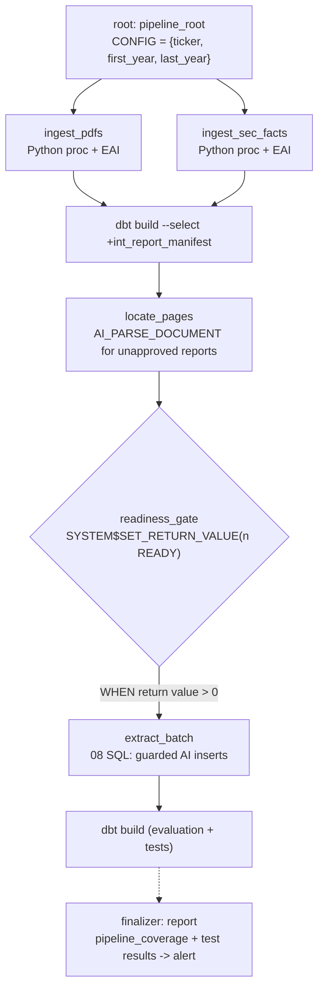

# From lab to production: dbt and a scheduled DAG

The lab runs as numbered files you execute in order (or all at once with
`python/00.run_pipeline.ipynb`). This guide shows where each piece goes when the same
pipeline is built for production with **dbt** (transformations and tests) and a
**Snowflake Task graph (DAG)** (scheduling and orchestration). It is a design map, not
code you run in the lab. Treat object names below as suggestions.

See [ARCHITECTURE.md](ARCHITECTURE.md) for the current flow, layers and table catalog.

## 1. Principles the lab already follows (keep them)

| Principle | In the lab today | In production |
| --- | --- | --- |
| One source of truth for configuration | scope (ticker, years, metric set `include_all_metrics`) set once in `lab_settings` (step 00) | task graph `CONFIG` or dbt `vars` |
| One rule, one place | SEC value: `metric_ground_truth`; metrics in play: `scope_metrics`; accepted SEC tags: `metric_sec_concepts`; status: `report_status` | one model per rule; every consumer `ref()`s it |
| Declared grain and keys for every table | constraints + table comments in 01 | dbt model contracts + `unique`/`not_null` tests |
| Idempotent, re-runnable steps | MERGE, `NOT EXISTS` guards, approved rows never overwritten | dbt incremental models; tasks safe to retry |
| Raw data is append-only | `sec_facts` upsert, AI results kept per run | raw schema written only by ingestion |
| Nothing is skipped silently | `pipeline_coverage` (scope), `report_status` (every ticker-year, all companies, with `next_step`), runner reports `SKIPPED` | status model + alert on any non-`Evaluated` row |
| Cost gates around AI | `RUN_AI_STEPS`, readiness gate, page filters | AI tasks behind the readiness gate, run only for new READY reports |
| Auditability | `review_notes` (AUTO-APPROVED / HUMAN-REVIEWED), `batch_id`, kept runs | same columns + task history and query tags |
| Independent ground truth | SEC XBRL facts, never derived from the AI answer | unchanged |

## 2. Physical layers

The lab keeps every object in one schema and documents layers logically. In production
split them physically so permissions and lineage follow the layer:

| Layer | Schema | Holds (lab object -> production name) |
| --- | --- | --- |
| CONFIG | `CONFIG` (or dbt seeds) | seeds `metric_catalog` (incl. `is_starter`), `metric_sec_concepts`, `statement_heading_patterns`; `lab_settings` -> task `CONFIG` |
| RAW | `RAW` | stage `annual_report_pdfs`, `sec_facts`, `ingest_log`, `statement_page_scan`, `parse_results`, `extraction_results` |
| STAGING | `STAGING` (dbt `stg_`) | typed, renamed one-to-one views of RAW tables |
| INTERMEDIATE | `INTERMEDIATE` (dbt `int_`) | `int_report_manifest`, `int_metric_ground_truth`, `int_scope_metrics`, `int_report_readiness`, `int_extracted_fields`, `int_sec_reference` |
| MARTS | `ANALYTICS` (dbt `fct_` / `dim_`) | `fct_metric_evaluation`, `fct_method_comparison`, `fct_report_status`, `fct_pipeline_coverage`, `fct_heading_pattern_usage`, `dim_report` |

## 3. dbt project mapping

| Lab piece | dbt piece | Notes |
| --- | --- | --- |
| `sec_facts`, stage directory, AI result tables | `sources:` in `models/sources.yml` | sources are written by Python/AI tasks, not by dbt |
| `metric_catalog` MERGE in 01 | `seeds/metric_catalog.csv` | `dbt seed`; tolerances and `is_starter` become reviewable CSV changes |
| `metric_sec_concepts` MERGE in 01 | `seeds/metric_sec_concepts.csv` | a new fallback tag is a reviewed CSV row with its `reason`; tests: one preference 1 per metric equal to `sec_concept`, `reason` not null |
| `statement_heading_patterns` MERGE in 01 | `seeds/statement_heading_patterns.csv` | `added_for` written once; usage computed by `fct_heading_pattern_usage` |
| 06 `metric_ground_truth` | `int_metric_ground_truth` | the only model that matches `sec_facts` to a metric; readiness and evaluation both `ref()` it |
| 06 `scope_metrics` | `int_scope_metrics` | reads `include_all_metrics` from `var()` / task CONFIG; readiness, extraction and status `ref()` it |
| `lab_number()` in 09 | macro `lab_number()` or a SQL UDF created by an `on-run-start` hook | |
| 04 propose period/accession | `int_report_period` (model) | pure SQL over `sec_facts` |
| `report_manifest` approvals | `int_report_manifest` = proposals **left join** a `manual_review` seed/table | keeps human overrides out of model code |
| 06 `report_readiness`, `pipeline_coverage` | `int_report_readiness`, `fct_pipeline_coverage` | |
| 09 views (`extracted_fields` ... `metric_evaluation`) | `stg_extraction_results` -> `int_normalized_extractions` -> `fct_metric_evaluation` | |
| 09 `report_status`, `method_comparison` | `fct_report_status`, `fct_method_comparison` | status drives the finalizer alert; comparison is the analyst mart |
| runner `ddl_applied` hash skip for 01 | not needed | dbt rebuilds only what changed; contracts and schema-change settings replace the hash check |
| 10 `unique` / `not_null` / `relationships` / `accepted_values` | `schema.yml` tests with the same names | 10's rows map one to one |
| 10 `lab_number` and tolerance cases | dbt unit tests (`unit_tests:`) | |
| Declared PK/FK in 01 | model `contract: {enforced: true}` + `constraints:` | documents grain in the model |

Keep **AI calls out of plain dbt SQL models**: they cost money on every rebuild. Either
run them as tasks before dbt (recommended, section 4), or as **incremental** dbt models
whose `is_incremental()` filter only selects READY reports that have no result yet,
which is the same guard as 08's `NOT EXISTS`.

Snowflake can run dbt natively (a `DBT PROJECT` object, deployed from Workspaces or
with `CREATE DBT PROJECT`), so the dbt run itself can be one task in the DAG.

## 4. Task graph (DAG)



- **Root task** holds the scope as task graph `CONFIG`; children read it with
  `SYSTEM$GET_TASK_GRAPH_CONFIG('ticker')`. A run for other years is
  `EXECUTE TASK pipeline_root USING CONFIG = $${"ticker": "AAPL", "first_year": 2021, "last_year": 2025, "include_all_metrics": false}$$`.
  This replaces `lab_settings`.
- **Ingestion** (`02`, `03`) becomes Python stored procedures created with
  `EXTERNAL_ACCESS_INTEGRATIONS = (public_filing_access)`; their `main(session)` already
  takes a session and reads the scope from one place.
- **Locate pages** (`05`) and **extract** (`08`) run their existing SQL; every insert is
  already guarded, so a retried task never duplicates rows or repeats AI cost.
  `python/export_notebook_sql.py` produces 08's SQL from the notebook.
- **Readiness gate** passes the number of READY reports to the next task with
  `SYSTEM$SET_RETURN_VALUE`; the extract task's `WHEN` skips the AI step when there is
  nothing to do.
- **Finalizer** always runs (even after a failure), reads `report_status` and the test
  results, and alerts on any row that is not `Evaluated`, quoting its `next_step`. A known
  source gap (e.g. TSLA 2021: no PDF at the course source) stays visible as
  `Stopped at 02` and is reported, not treated as a task failure.
- The **human manual override** (step 04's commented UPDATE) stays a reviewed, manual
  change (or a `manual_review` seed); it is never automated.
- **Monitoring**: `TASK_HISTORY` for runs and failures; `pipeline_coverage` for data
  completeness; query tags per step for cost reporting. The lab's runner already tags
  every statement `lab:<step file>` (see `python/sql_runner.py`).

### Cost by pipeline step (needs `SNOWFLAKE.ACCOUNT_USAGE` access; `ALL_USERS_ROLE` does not have it)

Check the column names against the
[CORTEX_FUNCTIONS_QUERY_USAGE_HISTORY](https://docs.snowflake.com/en/sql-reference/account-usage/cortex_functions_query_usage_history)
reference before relying on this; Account Usage views can lag by up to a few hours.

```sql
SELECT q.query_tag, u.function_name, COUNT(*) AS calls, SUM(u.token_credits) AS ai_credits
FROM snowflake.account_usage.cortex_functions_query_usage_history u
JOIN snowflake.account_usage.query_history q ON q.query_id = u.query_id
WHERE q.query_tag LIKE 'lab:%'
  AND q.start_time >= DATEADD('day', -7, CURRENT_TIMESTAMP())
GROUP BY ALL
ORDER BY ai_credits DESC;
```

Joined to `lab_runs.prompt_version` (via the batch's time window or a tag that includes
the batch id), this gives the cost-versus-accuracy comparison per extraction path.

## 5. Suggested migration order

1. Move tables into `RAW` / `CONFIG` schemas (or keep one schema and start with dbt sources).
2. Create the dbt project: sources, seeds (`metric_catalog` with `is_starter`, `metric_sec_concepts`,
   `statement_heading_patterns`), staging models.
3. Port 04, 06 and 09 views to `int_` / `fct_` models; port 10's checks to `schema.yml`.
4. Wrap 02/03 as stored procedures; schedule them under a root task.
5. Add the AI tasks (05, 08) behind the readiness gate; add the finalizer.
6. Retire `lab_settings` in favour of task `CONFIG` (ticker, years, `include_all_metrics`);
   `int_scope_metrics` then reads the CONFIG value. Keep `report_status` as the completeness
   check and alert source.
